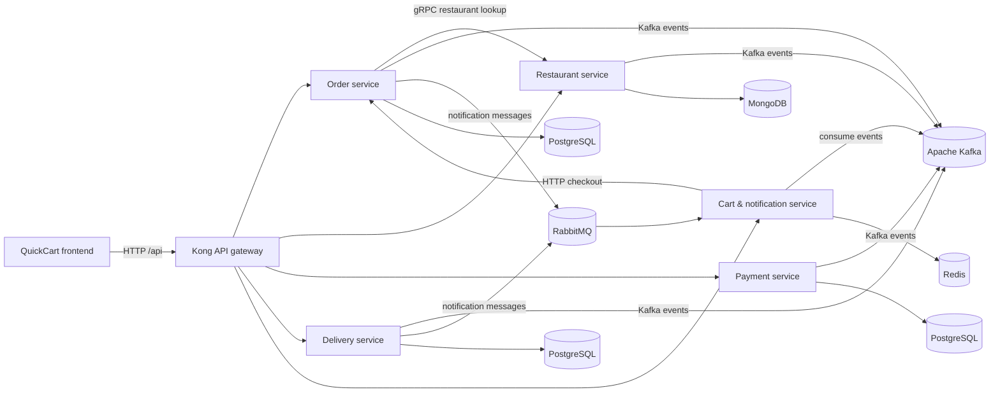

# QuickCart

QuickCart is a food-ordering platform implemented as a distributed microservice
system. A customer can browse restaurants, add items to a cart, place an order,
and track the order as payment and delivery events are processed. The platform
deliberately combines synchronous request/response communication for operations
that need an immediate answer with asynchronous messaging for long-running
workflow steps and notifications.

## Contents

- [Architecture at a glance](#architecture-at-a-glance)
- [Services and ownership](#services-and-ownership)
- [Synchronous communication](#synchronous-communication)
- [Asynchronous communication](#asynchronous-communication)
- [End-to-end order flow](#end-to-end-order-flow)
- [Technology stack](#technology-stack)
- [Repository layout](#repository-layout)
- [Run locally with Docker Compose](#run-locally-with-docker-compose)
- [Run on Kubernetes](#run-on-kubernetes)
- [Useful URLs and ports](#useful-urls-and-ports)
- [Testing the main flow](#testing-the-main-flow)
- [Reliability, consistency, and observability](#reliability-consistency-and-observability)
- [Implementation notes](#implementation-notes)

## Architecture at a glance



The runtime is packaged with Docker Compose. The Compose stack includes the
four domain services, the locally implemented cart/notification service, Kong,
the frontend, Kafka and ZooKeeper, RabbitMQ, Redis, the service databases, and
the Prometheus/Grafana/Loki observability components.

There are two Compose files:

- `docker-compose-hub.yml` is the currently usable full-stack definition. It
  pulls the order, restaurant, payment, and delivery images and builds the
  cart/notification and frontend containers locally.
- `docker-compose.yml` is a commented local-development/earlier stack
  definition. It is retained as configuration history and is not the default
  command.

## Services and ownership

### Runtime service matrix

| Service | Responsibility | Port | Storage | Primary communication |
|---|---|---:|---|---|
| Order service | Creates and manages orders; coordinates restaurant validation and publishes order events | 8081 | PostgreSQL (`orderdb`) | REST, gRPC client, Kafka, RabbitMQ |
| Restaurant service | Restaurant/menu operations and restaurant-side validation | 8082, gRPC 50051 | MongoDB (`restaurantdb`) | REST, gRPC server, Kafka |
| Payment service | Processes payment state for an order | 8083 | PostgreSQL (`paymentdb`) | REST, Kafka |
| Delivery service | Assigns and tracks delivery work | 8084 | PostgreSQL (`deliverydb`) | REST, Kafka, RabbitMQ |
| Cart & notification service | Cart CRUD, checkout façade, tracking read model, and user notifications | 8085 | Redis | REST, HTTP client, Kafka consumer, RabbitMQ consumer |
| Kong gateway | Single API entry point and route forwarding | 8080 (proxy), 8001 (admin) | Declarative YAML | HTTP proxy |
| QuickCart frontend | Customer shop, checkout, order tracking, and operations dashboard | 3001 | Browser local storage | HTTP through Kong |

### Implementation and attribution

The repository history records **Krish-bhavsar19** as the Git author for the
tracked implementation and integration work, including the cart/notification
service, deployment manifests, gateway configuration, Compose configuration,
and test scripts.

The remaining domain services are represented in this checkout by their
Dockerfiles and published images rather than their application source. The
image namespaces in `docker-compose-hub.yml` identify the image publishers:

| Service | Published image in this project | Attribution available from this repository |
|---|---|---|
| Order service | `aayushp255/order-service:latest` | Image published under `aayushp255`; application-source author is not verifiable here |
| Restaurant service | `harshkumar1601/restaurant-service:latest` | Image published under `harshkumar1601`; application-source author is not verifiable here |
| Payment service | `harshkumar1601/payment-service:v2` | Image published under `harshkumar1601`; application-source author is not verifiable here |
| Delivery service | `adityathakar/delivery-service:v3` | Image published under `adityathakar`; application-source author is not verifiable here |
| Cart & notification service | Built from `cart-notification/` | Implemented/integrated in this repository by Krish-bhavsar19 |
| Frontend and platform integration | Built from `frontend/` and root/infrastructure manifests | Implemented/integrated in this repository by Krish-bhavsar19 |

This table intentionally distinguishes **image publisher** from **verified
source-code author**. A Docker Hub namespace alone is not proof of every
person who contributed to a service.

## Synchronous communication

Synchronous calls keep the caller connected until a response is available.
QuickCart uses them for user-facing reads and commands that need an immediate
success or failure response:

1. **Browser -> Kong -> service (HTTP/REST).** The frontend sends requests to
   `/api`; Kong routes them to the appropriate service.
2. **Cart service -> order service (HTTP).** Checkout calls
   `POST /orders`. A successful response returns an order ID. If the order
   service is unavailable, the cart is preserved and checkout returns a
   service-unavailable result.
3. **Order service -> restaurant service (gRPC).** The Compose configuration
   exposes the restaurant gRPC server on port `50051`, allowing order
   validation/lookups without an HTTP round trip through the gateway.
4. **Reads from Redis.** Cart, order tracking, and notification endpoints
   synchronously read Redis so the API can return current data quickly.

The cart service protects its order-service HTTP client with Polly retry and
circuit-breaker policies. This prevents a temporary downstream failure from
causing indefinite waits and avoids repeatedly sending traffic to an
unhealthy dependency.

## Asynchronous communication

Asynchronous messages let services continue independently. They are used for
domain events, payment/delivery progression, and notifications.

### Kafka: domain events and tracking read model

Kafka topics provisioned by the Compose stack are:

| Topic | Meaning |
|---|---|
| `order.created` | An order was accepted/created |
| `order.confirmed` | The order passed confirmation |
| `order.cancelled` | The order was cancelled |
| `payment.completed` | Payment completed |
| `payment.failed` | Payment failed |
| `delivery.assigned` | A driver was assigned |

The cart/notification service consumes `order.created`, `order.confirmed`,
`order.cancelled`, `payment.failed`, and `delivery.assigned` in the
`cart-notification-service` consumer group. It updates a Redis CQRS read model
under `orderview:{orderId}`. This keeps order-tracking reads off the order
database and allows tracking to become available shortly after events arrive.

The consumer uses manual commits and an idempotency key based on topic,
partition, and offset (`processed:{eventId}` in Redis) so redelivered events do
not apply the same update repeatedly.

### RabbitMQ: direct notification delivery

RabbitMQ is used for point-to-point notification work:

- Exchange: `quickcart.notifications`
- Queue: `notification.queue`
- Routing key: `notification`
- Dead-letter exchange: `quickcart.notifications.dlx`
- Dead-letter queue: `notification.dlq`

The cart/notification service consumes notification messages, stores them in
Redis, and logs simulated email and SMS delivery. Messages are acknowledged
only after successful processing. Failed messages are retried and ultimately
rejected to the dead-letter queue after three attempts.

Kafka is therefore the broad domain-event bus, while RabbitMQ is the direct
notification work queue. They are complementary rather than interchangeable
in this design.

## End-to-end order flow

### Customer checkout

1. The frontend loads the menu through Kong and displays restaurant data.
2. The customer adds items. Cart requests go through Kong to the cart service.
3. The cart service stores items in a Redis hash named `cart:{userId}` with a
   24-hour TTL.
4. Checkout reads the cart and synchronously calls the order service.
5. The order service validates the order, including its restaurant dependency,
   persists order state, and returns an order ID.
6. On success, the cart service clears the Redis cart. On failure, it retains
   the cart so the customer can retry.

### Background order progression

1. The order service publishes an order event to Kafka.
2. Payment and delivery services consume the events relevant to them and
   publish their own state transitions.
3. The cart/notification Kafka consumer receives tracking events and updates
   `orderview:{orderId}` in Redis.
4. A tracking request reads that Redis view through
   `GET /orders/{orderId}/tracking`; it does not query the order database.
5. Notification-producing services publish a message to RabbitMQ.
6. The RabbitMQ consumer stores the notification under
   `notifications:{userId}` and logs simulated email/SMS delivery.
7. The frontend can retrieve the user’s notifications with
   `GET /notifications/{userId}`.

## Technology stack

### Application and integration

- **C# / .NET 8 / ASP.NET Core** for the cart and notification service.
- **Java/Spring-based order service integration** is indicated by its
  `SPRING_DATASOURCE_*` environment variables.
- **REST/HTTP and JSON** for public service APIs.
- **gRPC** for the order-to-restaurant internal call.
- **Apache Kafka 7.6.1** with ZooKeeper for durable domain events.
- **RabbitMQ 3.13** for notification queues and dead-letter handling.
- **Redis 7.2** for carts, notifications, CQRS tracking views, TTLs, and
  idempotency keys.

### Data stores

- **PostgreSQL 16** for order, payment, and delivery data, with one database
  container per bounded context.
- **MongoDB 7** for restaurant data.
- Named Docker volumes preserve local data between container restarts.

### Platform and operations

- **Docker and Docker Compose** for local orchestration.
- **Kubernetes** manifests for the `quickcart` namespace, including Deployments,
  Services, StatefulSets, HPA, Secrets, ConfigMaps, Ingress, and NetworkPolicy.
- **Minikube Ingress** for the documented local Kubernetes path.
- **Kong 3.7** as a declarative API gateway.
- **Prometheus** for metrics scraping and **Grafana** for dashboards.
- **Loki** and a **Promtail** sidecar for log forwarding in Kubernetes.
- **Serilog** with compact JSON console output.
- **Polly** for HTTP retries and circuit breaking.
- **Swagger/OpenAPI** for the .NET service in development.
- **Health checks** at `/health` and Prometheus metrics at `/metrics`.
- **HTML/CSS/JavaScript and Nginx** for the frontend container.

## Repository layout

```text
.
├── cart-notification/       .NET cart, tracking, and notification service
│   ├── Controllers/         REST controllers
│   ├── Consumers/           Kafka and RabbitMQ hosted consumers
│   └── Services/            Redis, cart, notification, and order-client logic
├── frontend/                Nginx image and QuickCart customer UI
├── infra/
│   ├── kong/kong.yaml       Declarative Kong routes
│   └── prometheus/          Prometheus scrape configuration
├── k8s/                     Kubernetes manifests and network policies
├── docker-compose-hub.yml   Full stack using published service images
├── docker-compose.yml       Commented local/earlier Compose definition
├── deploy.sh                Minikube/Kubernetes deployment script
├── test_flow.ps1            PowerShell checkout and tracking smoke test
└── test_flow.sh             Shell equivalent of the smoke test
```

## Run locally with Docker Compose

### Prerequisites

- Docker Desktop with Docker Compose v2
- At least 6 GB of memory allocated to Docker (more is recommended for Kafka,
  databases, and observability services)

### Start the stack

From the repository root:

```bash
docker compose -f docker-compose-hub.yml up -d
```

Check container status and logs:

```bash
docker compose -f docker-compose-hub.yml ps
docker compose -f docker-compose-hub.yml logs -f cart-notification
```

Open the customer UI at <http://localhost:3001>. The API gateway is available
at <http://localhost:8080>.

To stop the stack while retaining named volumes:

```bash
docker compose -f docker-compose-hub.yml down
```

To remove the containers and their persisted local data as well:

```bash
docker compose -f docker-compose-hub.yml down -v
```

The Compose file contains development credentials and local defaults. Do not
reuse those values in a production deployment.

## Run on Kubernetes

The supplied deployment script targets Minikube and applies resources in this
order: namespace/configuration, RabbitMQ and Redis, network policies, the
cart/notification Deployment, HPA, and Ingress.

```bash
minikube start
./deploy.sh
```

The script enables the Minikube Ingress addon. Add the following entry to the
local hosts file when using the Ingress hostname:

```text
127.0.0.1 quickcart.local
```

Inspect the deployment with:

```bash
kubectl get all -n quickcart
kubectl get ingress -n quickcart
kubectl logs -n quickcart deployment/cart-notification -c cart-notification
```

The Kubernetes manifests run two cart/notification replicas, enforce non-root
execution, define CPU/memory requests and limits, add liveness/readiness
probes, and attach a Promtail logging sidecar. The default-deny network policy
is supplemented with explicit service, database, Kafka, RabbitMQ, and Redis
rules.

## Useful URLs and ports

| URL | Purpose |
|---|---|
| <http://localhost:3001> | Customer frontend |
| <http://localhost:8080> | Kong proxy |
| <http://localhost:8001> | Kong admin API |
| <http://localhost:8085/health> | Cart/notification health check |
| <http://localhost:8085/metrics> | Cart/notification Prometheus metrics |
| <http://localhost:8085/swagger> | Development Swagger UI |
| <http://localhost:9090> | Prometheus |
| <http://localhost:3000> | Grafana |
| <http://localhost:3100> | Loki |
| <http://localhost:15672> | RabbitMQ management UI |

The direct service ports are `8081` (order), `8082` (restaurant), `8083`
(payment), `8084` (delivery), and `8085` (cart/notification). PostgreSQL is
mapped to host ports `5433`, `5434`, and `5435`; MongoDB is `27017`, Redis is
`6379`, Kafka is exposed on `29092` for host access, and RabbitMQ uses `5672`.

## Testing the main flow

With the Compose stack running, execute the PowerShell smoke test:

```powershell
.\test_flow.ps1
```

The script adds an item to a cart, reads the cart, checks out, waits briefly
for asynchronous processing, reads the CQRS tracking view, and retrieves
notifications. The Bash equivalent is:

```bash
./test_flow.sh
```

Because Kafka and RabbitMQ processing is asynchronous, tracking and
notifications may not be available immediately after checkout. A short
eventual-consistency delay is expected.

## Reliability, consistency, and observability

- **Eventual consistency:** tracking and notifications are updated after
  messages are consumed, rather than in the checkout request.
- **CQRS:** Redis stores a read-optimized order view for high-frequency
  tracking requests.
- **Idempotency:** Kafka offsets and RabbitMQ delivery identifiers are recorded
  in Redis with a 48-hour TTL.
- **Retry and circuit breaking:** Polly protects the cart-to-order HTTP call.
- **Dead-letter handling:** notification failures go to `notification.dlq`
  after three attempts.
- **Health probes:** the cart service exposes `/health`; Kubernetes uses it for
  liveness and readiness.
- **Metrics:** `/metrics` is scraped by Prometheus for the configured services.
- **Structured logs:** Serilog emits compact JSON, and Kubernetes can forward
  application logs with Promtail to Loki.
- **Isolation:** each major domain has its own database, and Kubernetes
  NetworkPolicies restrict cross-service traffic.

## Implementation notes

- Cart data is intentionally short-lived: entries expire after 24 hours.
- Notifications are capped at the latest 20 per user and expire after seven
  days.
- Tracking views expire after seven days.
- Processed-event markers expire after 48 hours.
- The current notification implementation logs email and SMS delivery rather
  than integrating an external provider.
- The frontend uses `/api` paths, so Kong is the intended public entry point;
  direct internal service ports are primarily useful for diagnostics.

## License and contribution

No license file is currently included in the repository. Add an explicit
license before distributing the project outside its intended assignment or
team context. When extending the system, update the service matrix, event
topics, flow description, and deployment instructions together with the code.
